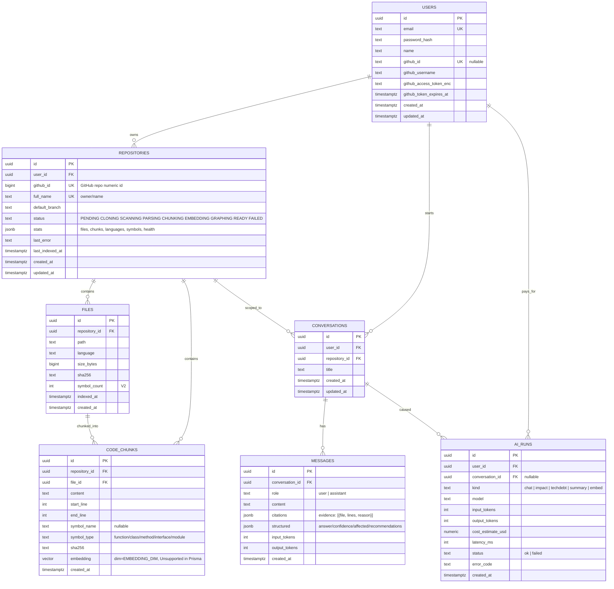

# CodeAtlas — Database Design (ER)

**Engine:** PostgreSQL 16 with the `pgvector` extension (0.8). **ORM:** Prisma 6 — schema-first.
Vector columns are declared `Unsupported("vector(1536)")` in Prisma and queried via `$queryRaw`
(Prisma has no native vector type; the raw layer also lets us do hybrid search later).

**ID convention:** `uuid` (v4) PKs for all tables; `created_at`/`updated_at` `timestamptz` on every
table. **Scoping:** every content table carries the owning `user_id` (MVP) so a single predicate
enforces tenancy everywhere (defense in depth — see `security.md`).

> MVP rule: the schema below is exactly what the MVP needs. Symbols/dependencies/commits/PRs/issues
> are **V2**; orgs, API keys, usage, billing are **V4**. Design them now so migrations are additive,
> but do not build them in Phase 1.

## Tables — MVP (Phase 1–8)

### `users`

- `email` unique + citext; `password_hash` argon2id (never bcrypt-without-cost-factor… use argon2id).
- `github_*` populated after OAuth connect. `github_access_token_enc` = AES-256-GCM encrypted token
  (key from `ENCRYPTION_KEY`). Never return it from the API.

### `repositories`

- `status` drives the whole UI lifecycle; `stats` is a JSONB snapshot (files_count, chunks_count,
  languages histogram, symbol counts, health_score) refreshed at end of ingestion so dashboards
  don't aggregate on every page load.
- Index: `(user_id, status)`, `(user_id, updated_at DESC)` for the dashboard list.

### `files`

- Unique `(repository_id, path)`. `sha256` lets re-ingestion skip unchanged files (incremental
  index, V2 optimization — MVP can still hash cheaply and skip re-embedding).
- Index: `(repository_id, language)`, `(repository_id, path)`.

### `code_chunks`

- **The retrieval unit.** Store a code excerpt with line range and optional symbol metadata
  (symbol_name/symbol_type from the parser, V2; MVP emits file-level chunks with `symbol_name=NULL`).
- `embedding` is the pgvector column; **dimension must equal `EMBEDDING_DIM`** — set once at
  migration time. Changing embedding models later requires a re-embed (migration path documented in
  `ai-rag.md`).
- Indexes:
  - `embedding vector_cosine_ops` (HNSW, `m=16, ef_construction=64`) — powers `ORDER BY
embedding <=> $query LIMIT k` (cosine distance).
  - `(repository_id, file_id)`, `(repository_id, embedding vector_cosine_ops)` for repo-scoped
    search (partial index or composite — see below).
- **Indexing note:** the per-repository index `(repository_id, embedding vector_cosine_ops)` is the
  one the hot path uses (`WHERE repository_id = $1 ... ORDER BY embedding <=> $2 LIMIT k`). This
  keeps search cheap even when the table grows across many repos. A global HNSW index is a V4
  decision once multi-tenant search matters.

### `conversations`, `messages`

- Messages store the rendered markdown, the structured answer (`confidence`, `affected_components`,
  `recommendations`), and validated citations. Citations must reference real files — validation
  happens in the API before persistence (`ai-rag.md` §5).
- Index: `(conversation_id, created_at)`.

### `ai_runs`

- Cost/observability ledger. Every Claude call (chat, embed batch, V2 analyses) writes one row:
  tokens in/out, model, latency, estimated cost (rate table in `packages/shared`). Powers the usage
  dashboard and V4 billing.

## Tables — V2 (designed now, built later)

| Table                      | Purpose                                                | Key columns                                                                                          |
| -------------------------- | ------------------------------------------------------ | ---------------------------------------------------------------------------------------------------- |
| `symbols`                  | Parsed functions/classes/methods/interfaces/components | `(repository_id, file_id)`, `name`, `kind`, `start_line`, `end_line`, `signature`, `doc`             |
| `dependencies`             | Edges: file→file imports, symbol→symbol calls, extends | `(repository_id, source_file_id)`, `target`, `kind` (import/call/extends), `resolved_target_file_id` |
| `commits`                  | GitHub commit history cache                            | `(repository_id, sha)` unique, author, message, stats                                                |
| `pull_requests` / `issues` | GitHub issue/PR cache for Git intelligence             | `(repository_id, github_number)` unique, state, title, body, labels                                  |
| `architecture_decisions`   | ADR-style notes + AI-generated architecture summaries  | `(repository_id, path)` unique                                                                       |

All of these are **caches of GitHub data** with `repository_id` scope — fetched by the worker,
stored relationally (no graph DB; §13 of the spec: a graph database is not justified yet).

## Tables — V4 (deferred, do not build)

`organizations`, `organization_members`, `repository_members`, `api_keys` (key hash, prefix,
scopes, last_used_at), `usage` (per-period token/cost rollups), `subscriptions`/`invoices`
(Stripe). Schema migrations are additive; nothing in the MVP schema blocks these.

## Migration strategy

- `prisma migrate dev` locally; `prisma migrate deploy` in CI/prod. Every migration is additive.
- The `vector` column and HNSW indexes are created by hand-written SQL appended to the migration
  (Prisma generates the rest). `CREATE EXTENSION IF NOT EXISTS vector;` is part of migration 1 and
  mirrored in the docker-compose init and managed-DB provisioning.
- Idempotent seed: one demo user (email/password) so the app is explorable without GitHub OAuth.
